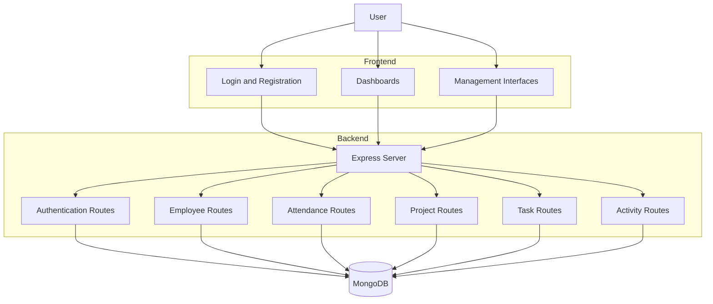

# KEEP-TRACK — Employee Management System

<p align="center">
  
  
  
  
  
</p>

<p align="center">
  <strong>One workspace. Every employee. Every task. Every milestone.</strong>
</p>

<p align="center">
  KEEP-TRACK is a web-based employee management system designed to organize employee information, track attendance, manage projects and tasks, and monitor workplace activities.
</p>

<p align="center">
  <a href="#overview">Overview</a> •
  <a href="#features">Features</a> •
  <a href="#architecture">Architecture</a> •
  <a href="#getting-started">Getting Started</a> •
  <a href="#api-reference">API Reference</a>
</p>

---

## Table of Contents

- [Overview](#overview)
- [Problem Statement](#problem-statement)
- [Features](#features)
- [Application Modules](#application-modules)
- [Technology Stack](#technology-stack)
- [Architecture](#architecture)
- [Project Structure](#project-structure)
- [Getting Started](#getting-started)
- [Environment Configuration](#environment-configuration)
- [API Reference](#api-reference)
- [Security Considerations](#security-considerations)
- [Available Scripts](#available-scripts)
- [Future Roadmap](#future-roadmap)
- [Contributing](#contributing)
- [Author](#author)

---

## Overview

**KEEP-TRACK** is an employee management application built using Node.js, Express.js, and MongoDB.

The platform provides a centralized workspace for managing employee records, monitoring attendance, organizing projects, assigning tasks, and maintaining activity records.

It includes separate dashboard interfaces for administrators, managers, and employees.

The goal is to simplify everyday employee and workplace management through a single application.

## Problem Statement

Managing employees, attendance, projects, and daily tasks across separate systems can make workplace coordination difficult.

KEEP-TRACK aims to provide:

- Centralized employee information.
- Organized attendance records.
- Project and task management.
- Role-oriented dashboard interfaces.
- Employee activity tracking.
- A unified management experience.

## Features

### 1. Employee Management

- Add and view employee records.
- Update employee information.
- Delete employee records.
- Maintain department and role details.
- Store employee profile information.

### 2. Authentication

- User registration and login.
- Password hashing using bcryptjs.
- JWT-based authentication tokens.
- Role information associated with user accounts.

### 3. Attendance Management

- Employee check-in.
- Employee check-out.
- Daily attendance records.
- Prevention of duplicate daily check-ins.
- Attendance history.

### 4. Project Management

- Create projects.
- View project records.
- Update project information.
- Organize project-related information.

### 5. Task Management

- Create and view tasks.
- Update task status.
- Organize employee tasks.
- Maintain task records.

### 6. Dashboard and Analytics

- Management dashboard.
- Employee dashboard.
- Manager dashboard.
- Analytics interface.
- Employee and workplace information views.

### 7. Activity Tracking

- Record employee-related activities.
- View activity history.
- Delete activity records.

---

## Application Modules

| Module | Purpose |
|---|---|
| Login | User authentication |
| Registration | New user registration |
| Dashboard | Management overview |
| Employees | Employee record management |
| Attendance | Check-in and check-out |
| Projects | Project management |
| Tasks | Task management |
| Analytics | Workplace analytics interface |
| Employee Dashboard | Employee workspace |
| Manager Dashboard | Manager workspace |
| Settings | Application settings interface |

---

## Technology Stack

### Backend

| Technology | Purpose |
|---|---|
| Node.js | JavaScript runtime |
| Express.js | Backend framework |
| MongoDB | NoSQL database |
| Mongoose | Database modeling and queries |
| bcryptjs | Password hashing |
| JSON Web Token | Authentication tokens |
| dotenv | Environment configuration |
| CORS | Cross-origin resource sharing |

### Frontend

| Technology | Purpose |
|---|---|
| HTML5 | Application structure |
| CSS3 | Styling and layouts |
| JavaScript | Frontend functionality |

### Development Tools

- Visual Studio Code
- npm
- Git
- GitHub
- Nodemon

---

## Architecture

KEEP-TRACK follows a modular client-server architecture.



### Application Flow

1. Users access the application through the browser.
2. Registration and login requests are handled by the Express backend.
3. Passwords are hashed before being stored.
4. Authentication generates a JWT token.
5. Frontend modules communicate with backend API routes.
6. Employee, attendance, project, task, and activity records are managed through MongoDB.

---

## Project Structure

```text
KEEP-TRACK/
│
├── config/
│   └── db.js
│
├── controllers/
│   └── authController.js
│
├── models/
│   ├── Activity.js
│   ├── Attendance.js
│   ├── Employee.js
│   ├── Project.js
│   ├── Task.js
│   └── User.js
│
├── public/
│   ├── css/
│   │   ├── auth.css
│   │   └── style.css
│   │
│   ├── js/
│   │   ├── app.js
│   │   ├── dashboard.js
│   │   ├── employee.js
│   │   ├── manager.js
│   │   └── register.js
│   │
│   └── pages/
│       ├── analytics.html
│       ├── attendance.html
│       ├── dashboard.html
│       ├── employee-dashboard.html
│       ├── employees.html
│       ├── login.html
│       ├── manager-dashboard.html
│       ├── my-attendance.html
│       ├── my-projects.html
│       ├── my-tasks.html
│       ├── projects.html
│       ├── register.html
│       ├── settings.html
│       └── tasks.html
│
├── routes/
│   ├── activityRoutes.js
│   ├── attendanceRoutes.js
│   ├── authRoutes.js
│   ├── employeeRoutes.js
│   ├── projectRoutes.js
│   ├── taskRoutes.js
│   └── userRoutes.js
│
├── .gitignore
├── package.json
├── package-lock.json
├── server.js
└── README.md
```

---

## Getting Started

Follow these instructions to run KEEP-TRACK locally.

### Prerequisites

Install the following:

- Node.js
- npm
- MongoDB or MongoDB Atlas
- Git

### 1. Clone the Repository

```bash
git clone https://github.com/manjunath-novus/KEEP-TRACK.git
```

### 2. Navigate to the Project

```bash
cd KEEP-TRACK
```

### 3. Install Dependencies

```bash
npm install
```

### 4. Configure Environment Variables

Create a `.env` file in the project root.

```env
PORT=5000
MONGO_URI=your_mongodb_connection_string
```

### 5. Start the Development Server

```bash
npm run dev
```

### 6. Open the Application

Visit:

```text
http://localhost:5000
```

The application should now be accessible locally.

---

## Environment Configuration

| Variable | Description |
|---|---|
| `PORT` | Backend server port |
| `MONGO_URI` | MongoDB connection string |

**Important:** Keep database credentials and private configuration outside source control. Do not commit `.env` files.

---

## API Reference

The backend provides REST API routes for the main application modules.

### Authentication

| Method | Endpoint | Description |
|---|---|---|
| POST | `/api/auth/register` | Register a user |
| POST | `/api/auth/login` | Authenticate a user |

### Employee Management

| Method | Endpoint | Description |
|---|---|---|
| GET | `/api/employees/all` | Retrieve employees |
| POST | `/api/employees/add` | Add an employee |
| PUT | `/api/employees/update/:id` | Update employee information |
| DELETE | `/api/employees/delete/:id` | Delete an employee |

### Attendance

| Method | Endpoint | Description |
|---|---|---|
| POST | `/api/attendance/checkin` | Record check-in |
| PUT | `/api/attendance/checkout/:email` | Record check-out |
| GET | `/api/attendance/all` | Retrieve attendance records |

### Projects

| Method | Endpoint | Description |
|---|---|---|
| GET | `/api/projects/all` | Retrieve projects |
| POST | `/api/projects/add` | Create a project |
| PUT | `/api/projects/update/:id` | Update a project |

### Tasks

| Method | Endpoint | Description |
|---|---|---|
| GET | `/api/tasks/all` | Retrieve tasks |
| POST | `/api/tasks/add` | Create a task |
| PUT | `/api/tasks/update/:id` | Update task status |

### Activities

| Method | Endpoint | Description |
|---|---|---|
| GET | `/api/activity/all` | Retrieve activities |
| POST | `/api/activity/add` | Record an activity |
| DELETE | `/api/activity/delete/:id` | Delete an activity |

---

## Security Considerations

The project includes foundational security mechanisms:

- Password hashing using bcryptjs.
- JWT token generation.
- Environment-based database configuration.
- MongoDB data persistence.

**Before production deployment:**

- Move the hardcoded JWT signing secret into a private environment variable.
- Add JWT verification middleware to protected routes.
- Implement role-based authorization on backend endpoints.
- Validate and sanitize incoming API requests.
- Restrict CORS to trusted origins.
- Avoid logging passwords or login credentials.
- Never expose database credentials or private secrets.

---

## Available Scripts

Run these commands from the project root.

| Command | Description |
|---|---|
| `npm install` | Install dependencies |
| `npm run dev` | Start development server with Nodemon |
| `npm start` | Start production server |

---

## Future Roadmap

Potential improvements for future development:

- [ ] Stronger authentication and authorization.
- [ ] Role-based access control.
- [ ] Improved attendance reports.
- [ ] Advanced employee analytics.
- [ ] Project progress tracking.
- [ ] Task assignment and deadlines.
- [ ] Notification system.
- [ ] Automated testing.
- [ ] Production deployment.
- [ ] Improved mobile responsiveness.

---

## Contributing

Contributions, suggestions, and feedback are welcome.

1. Fork the repository.
2. Create a feature branch.
3. Implement your changes.
4. Test the application.
5. Submit a pull request with a clear description.

```bash
git checkout -b feature/your-feature
```

---

## Author

**Manjunath Halli**

Computer Science Engineering Student | Software Development | Cloud Computing

- GitHub: [@manjunath-novus](https://github.com/manjunath-novus)
- Repository: [KEEP-TRACK](https://github.com/manjunath-novus/KEEP-TRACK)

---

<p align="center">
  <strong>KEEP-TRACK</strong>
  <br />
  Bringing people, projects, and productivity together.
  <br /><br />
  <sub>Built as an engineering portfolio project.</sub>
</p>
